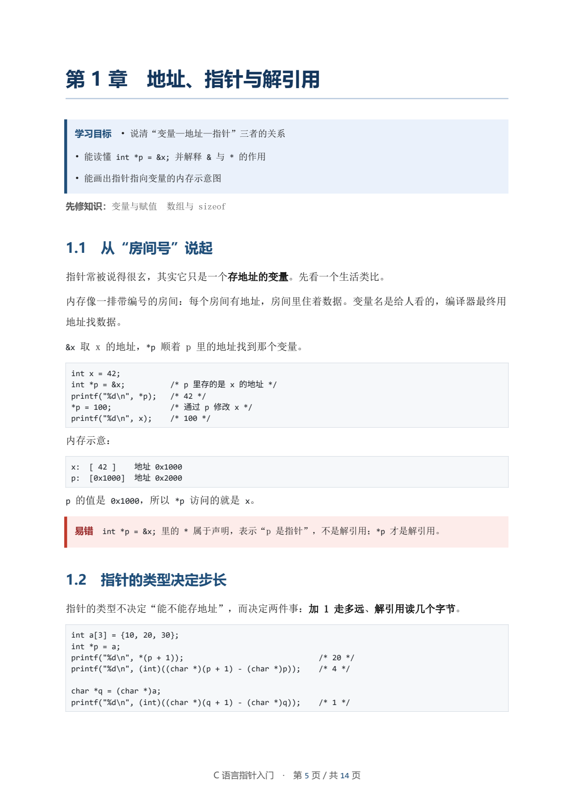

# Course Handout Studio

[中文](README.md) | English

[](https://github.com/Nounoumm/course-handout-studio/actions/workflows/ci.yml)

A student-facing plugin for DeepSeek Harness: a student asks for a topic, the assistant expands it into a **modular handout with complete knowledge points**, adds worked examples, common mistakes, and tiered exercises, then exports **DOCX + PDF** in one step.




## What it does

| Tool | Purpose |
|---|---|
| `handout_templates` | Lists four templates: standard textbook, exam review, project-driven, bilingual |
| `handout_scaffold` | Writes a module → chapter → section spec (JSON) with objectives, section placeholders, and exercise skeletons |
| `handout_check` | Validates structure, empty sections, length, objectives/summary, exercise/answer counts |
| `handout_build` | Renders DOCX and converts it to PDF through Harness `officeToPdf` |

It also registers the `course-handout` skill, which encodes chapter design, a knowledge-point checklist, how to align with public video courses, exercise design rules, and a pre-delivery checklist.

### Teaching design

- **Structure**: 2–4 modules, 2–4 chapters per module, 2–6 sections per chapter; no "Chapter 0" or "Miscellaneous" buckets.
- **Double helix**: motivating problem → precise definition → why it works → worked examples → common mistakes → summary. It combines the complete knowledge chain of Chinese textbooks with the intuition, diagrams, and misconception-first style of English textbooks.
- **Knowledge-point checklist**: bilingual terms, notation and conditions of use, method steps, examples, counterexamples, chapter summary, tiered exercises with answers.
- **Video alignment**: optionally searches public course outlines (China University MOOC, XuetangX, Bilibili, MIT OCW, Khan Academy, etc.), borrows only sequencing, and cites real links in the appendix. It never reproduces copyrighted material.
- **Exercises**: basic / intermediate / challenge tiers; answers must show key steps.

## Install

### From the plugin store (Discover)

The DSH plugin store is driven by user-configured **market indexes**. This repository ships a format-1 index:

```text
https://raw.githubusercontent.com/Nounoumm/course-handout-studio/main/market/index.json
```

1. Open **Plugins → More** (Experimental plugins) and enable **Custom plugin markets**.
2. Go to **Discover → Add index** and paste the URL above.
3. Find **Course Handout Studio** and install it.

### Direct install

```text
plugin_manager install_bundle
target: git+https://github.com/Nounoumm/course-handout-studio.git#7808c128cc3f70230ee1ca2b4bad288fb0e32695
```

Or clone the repository and install the local directory (for development):

```text
plugin_manager install_bundle
target: <absolute path to this repository>
```

The tools and skill appear immediately; no restart is needed. The package name is `@local/course-handout`.

### Runtime

- **Python**: the plugin checks `DSH_PYTHON`, then `$DSH_HOME/dsh-runtimes/*/dependencies/python`, then the installation's `resources/runtime/*/dependencies/python`, and finally `python3` / `python` on `PATH`. The runtime shipped with Harness is sufficient.
- **PDF**: converted by the host's `officeToPdf` service; no system LibreOffice is required.
- **Output**: defaults to `<workspace>/handouts`, overridable with `handout_build`'s `output_dir`.

## Usage

Ask in a session:

> Make a handout on Newton's laws for a first-year high-school student, standard textbook style, 8 chapters, with basic and intermediate exercises.

The assistant clarifies the essentials, writes `handouts/*.json`, fills in the content, validates it, and exports DOCX and PDF.

### Example

`examples/c-pointer-demo.json` is a complete 4-chapter, 8-section, 15-question spec:

```text
handout_check  spec_path: examples/c-pointer-demo.json
handout_build  spec_path: examples/c-pointer-demo.json
```

## Spec format

A handout is described by one JSON file; section bodies use lightweight Markdown. See [`skills/course-handout.md`](skills/course-handout.md) for the full schema, Markdown syntax, and writing rules. Minimal example:

```json
{
  "schema": "course-handout/1",
  "meta": { "title": "Example handout", "audience": "Beginners" },
  "modules": [
    {
      "title": "Part 1 — Foundations",
      "chapters": [
        {
          "title": "Chapter 1 — Getting started",
          "objectives": ["Objective one", "Objective two"],
          "sections": [{ "title": "1.1 Introduction", "body": "Text..." }],
          "summary": ["Summary one", "Summary two"],
          "exercises": { "basic": ["Exercise"] },
          "answers": ["Answer"]
        }
      ]
    }
  ]
}
```

## Implementation

```
index.js                   Host plugin: tool and skill registration
builder/handout_builder.py DOCX rendering, Markdown parsing, spec validation
skills/course-handout.md   Teaching method and workflow
examples/                  Example spec
docs/                      README preview images
locale/{zh,en}.json        Plugin title and description
icon.svg                   Plugin icon
```

- The Node side uses only Harness services (`tools`, `skills`, `subprocess`, `officeToPdf`, `workingDirectory`); no third-party npm dependencies.
- The Python side uses only `python-docx`, which ships with the Harness runtime, for OOXML layout.
- PDFs are converted in memory by `officeToPdf`; no system LibreOffice call.

## License

MIT
