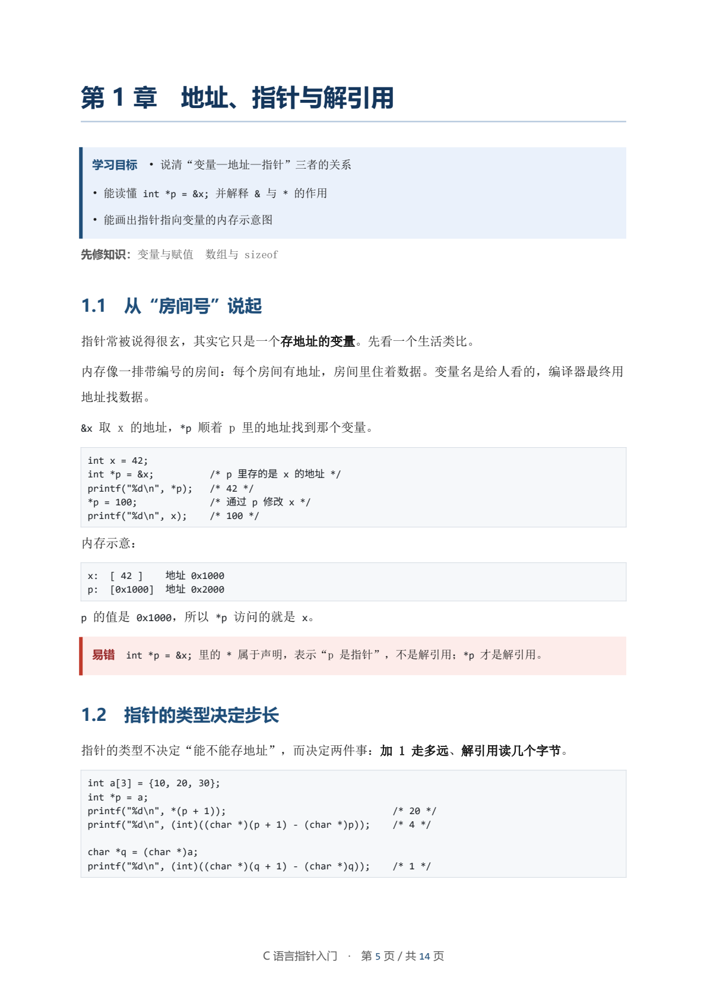

# 课程讲义工坊 · Course Handout Studio

面向学生的 Harness 插件：学生提出一个主题，助手把它扩展成**模块化、知识点齐全**的讲义，补全例题、易错点与分层习题，然后一键生成 **DOCX + PDF**。




## 它能做什么

| 工具 | 作用 |
|---|---|
| `handout_templates` | 列出四种模板：标准教材型、考前复习型、项目驱动型、双语对照型 |
| `handout_scaffold` | 按主题生成模块—章—节骨架（JSON），含学习目标、小节占位、习题框架 |
| `handout_check` | 检查结构、空小节、篇幅、学习目标与小结、习题与答案数量 |
| `handout_build` | 渲染 DOCX，并调用 Harness 的 `officeToPdf` 转成 PDF |

同时注册技能 `course-handout`，其中固化了章节设计、知识点清单、视频素材结合方式、习题设计规范和交付前检查。

### 教学设计

- **结构**：2–4 个模块，每模块 2–4 章，每章 2–6 节；拒绝“第 0 章”“杂项”这类分章。
- **双螺旋写法**：问题引入 → 严格定义 → 解释“为什么” → 例题 → 易错点 → 小结，兼顾中文教材的完整知识链与英文教材的直觉、图解和常见错误。
- **知识点清单**：术语中英对照、符号与适用条件、方法步骤、例题、反例、章末小结、分层习题与答案。
- **视频素材**：按需检索公开课程大纲（中国大学 MOOC、学堂在线、B 站、MIT OCW、Khan Academy 等），只借鉴章节顺序，并在附录给出真实链接，不复制受版权保护的内容。
- **习题**：基础 / 提高 / 挑战三层，答案写出关键步骤。

## 安装

先把仓库克隆到本机，然后在 Harness 会话里安装本地 bundle：

```text
plugin_manager install_bundle
target: <本仓库的绝对路径>
```

安装后无需重启，工具与技能会立即出现在当前 profile 中。插件包名为 `@local/course-handout`。

### 运行环境

- **Python**：插件依次检查 `DSH_PYTHON`、`$DSH_HOME/dsh-runtimes/*/dependencies/python`、安装目录下的 `resources/runtime/*/dependencies/python`，最后回退到 PATH 上的 `python3` / `python`。Harness 自带运行时即可。
- **PDF**：通过 Host 的 `officeToPdf` 服务转换，不依赖系统 LibreOffice。
- **输出目录**：默认 `<工作区>/handouts`，可用 `handout_build` 的 `output_dir` 覆盖。

## 使用

在会话里直接说：

> 帮我给高一学生做一份“牛顿运动定律”的讲义，标准教材型，8 章，带基础和提高到。

助手会先确认关键信息，再生成 `handouts/*.json`、补全内容、检查并产出 DOCX 与 PDF。

### 示例

`examples/c-pointer-demo.json` 是一份 4 章 8 节 15 题的完整规格，可直接构建：

```text
handout_check  spec_path: examples/c-pointer-demo.json
handout_build  spec_path: examples/c-pointer-demo.json
```

## 规格文件

讲义由一个 JSON 描述，正文用轻量 Markdown。完整字段、Markdown 语法和写作规范见 [`skills/course-handout.md`](skills/course-handout.md)。最小示例：

```json
{
  "schema": "course-handout/1",
  "meta": { "title": "示例讲义", "audience": "初学者" },
  "modules": [
    {
      "title": "第一部分 基础",
      "chapters": [
        {
          "title": "第 1 章 开始",
          "objectives": ["目标一", "目标二"],
          "sections": [{ "title": "1.1 引入", "body": "正文……" }],
          "summary": ["小结一", "小结二"],
          "exercises": { "basic": ["练习题"] },
          "answers": ["参考答案"]
        }
      ]
    }
  ]
}
```

## 实现

```
index.js                   Host 插件：工具与技能注册
builder/handout_builder.py DOCX 渲染、Markdown 解析、规格检查
skills/course-handout.md   教学法与工作流说明
examples/                  示例规格
docs/                      README 预览图
locale/{zh,en}.json        插件名称与描述
icon.svg                   插件图标
```

- Node 侧只使用 Harness 的服务（`tools`、`skills`、`subprocess`、`officeToPdf`、`workingDirectory`），不引入第三方 npm 依赖。
- Python 侧只使用 `python-docx`（Harness 运行时自带），负责 OOXML 排版。
- 生成的 PDF 由 `officeToPdf` 在内存中转换，不调用系统 LibreOffice。

## 许可

MIT
